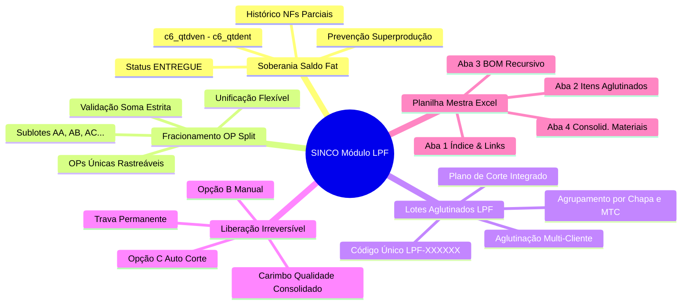
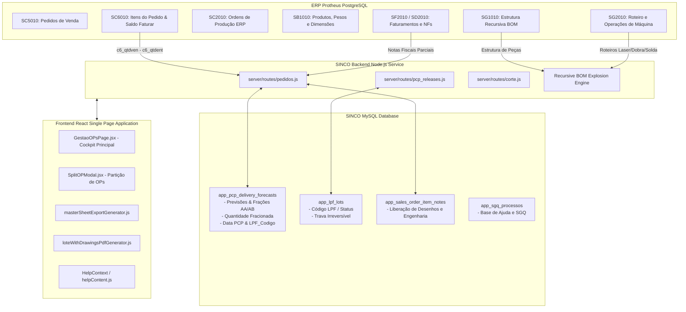
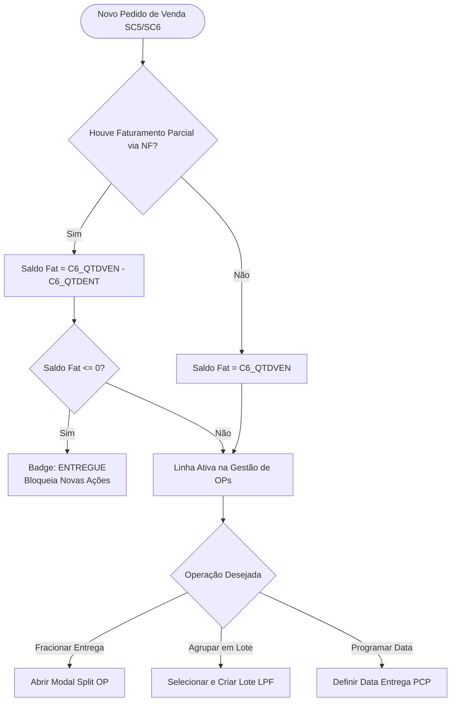
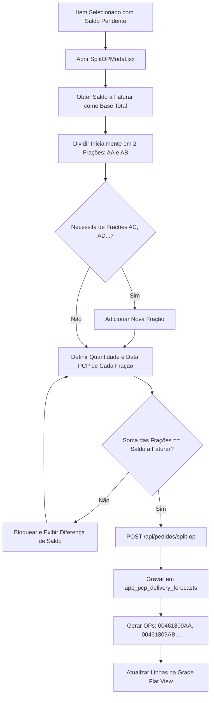
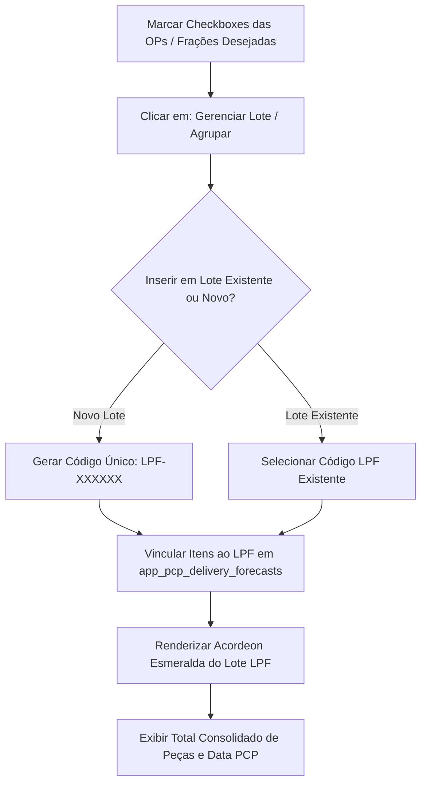
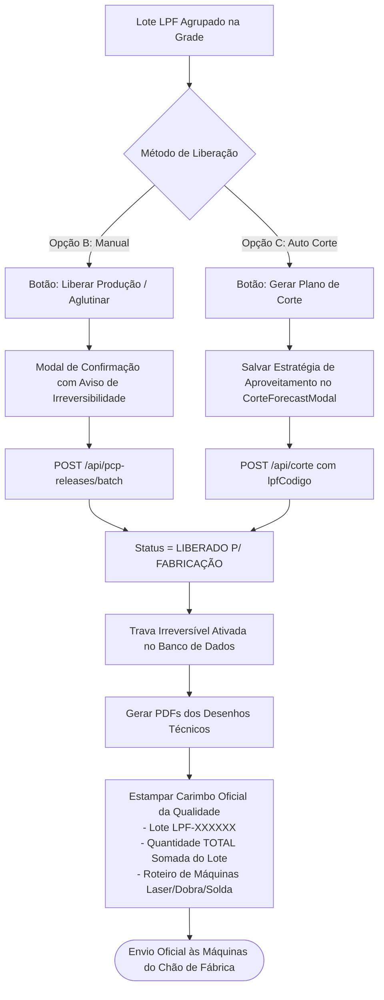
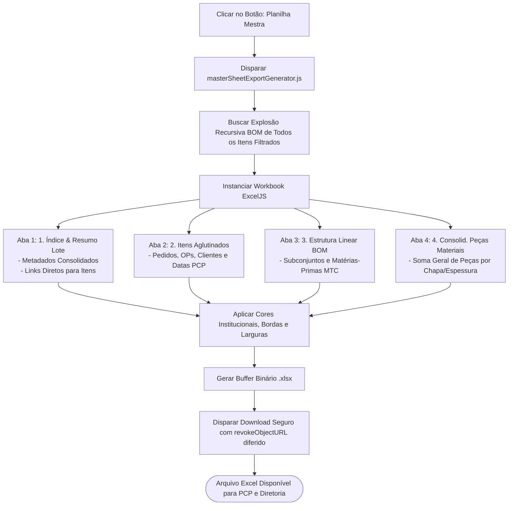

# 📑 Relatório de Entrega & Homologação em Produção
## Módulo: Gestão de OPs por Lote (LPF), Fracionamento de OPs & Liberação Irreversível
**Sistema:** SINCO / MetalFisa Indústria Metalúrgica  
**Versão Homologada:** `3.8.0-PROD`  
**Servidor de Produção:** `192.168.1.77:3001`  
**Data da Homologação:** 28 de Agosto de 2026  
**Status:** 🟢 **100% Homologado e em Produção**

---

## 📑 1. RESUMO EXECUTIVO DA ENTREGA

Este documento formaliza a entrega e homologação em produção do módulo de **Gestão de OPs por Lote**, **Fracionamento de OPs**, **Aglutinação Fabril**, **Controle por Saldo a Faturar** e **Liberação Irreversível com Carimbo da Qualidade**.

O módulo atende com precisão às necessidades operacionais de PCP, Engenharia e Chão de Fábrica da Metalfisa, integrando os dados em tempo real do **ERP Protheus (PostgreSQL)** com a inteligência de planejamento do **SINCO (MySQL)**.

---

## 2. ARQUITETURA DE DADOS & INTEGRAÇÃO HÍBRIDA

O fluxo de dados transita entre o banco corporativo Protheus e o banco de inteligência fabril SINCO:

---

## 3. ESPECIFICAÇÃO DAS REGRAS DE NEGÓCIO

### 3.1. Regra Soberana de Saldo a Faturar
$$\text{Saldo a Faturar} = \text{GREATEST}(C6\_QTDVEN - C6\_QTDENT, 0)$$

- **Prevenção de Desperdício:** Itens com faturamentos parciais no ERP utilizam **estritamente o saldo pendente restante** como quantidade máxima para programação PCP, corte de chapas e fracionamento.
- **Conclusão de Itens:** Saldo zero ($C6\_QTDVEN \le C6\_QTDENT$) marca o item como **`ENTREGUE`**, desabilitando novas ações produtivas.

### 3.2. Fracionamento de OPs (Split AA, AB, AC...)
- O total distribuído entre as frações deve ser **$100\%$ idêntico ao Saldo a Faturar**.
- O sistema atribui sufixos alfabéticos (`AA`, `AB`, `AC`...) e gera códigos de OP específicos (ex: `00461809AA`).
- Cada fração herda sua própria **Data de Entrega PCP** e quantidade fracionada.

### 3.3. Aglutinação em Lote LPF (`LPF-XXXXXX`)
- Permite agrupar itens de diferentes pedidos e clientes que compartilham a mesma matéria-prima (MTC) e espessura de chapa.
- Exibe o cabeçalho consolidado com o total de peças do lote e data de entrega sincronizada.

### 3.4. Liberação Irreversível (Opções B e C)
- **Opção B (Manual):** Acionada pelo botão `[Liberar Produção / Aglutinar]`.
- **Opção C (Automática ao gerar Corte):** Ao abrir o `CorteForecastModal` a partir do lote e salvar a estratégia de corte.
- **Trava de Integridade:** Após liberado, o lote recebe a badge `🟢 LIBERADO P/ FABRICAÇÃO` e entra em modo permanente (proibido desmembrar, excluir ou reverter).

---

## 4. FLUXOGRAMAS OPERACIONAIS E ARQUITETURA DE PROCESSOS

### 🔄 Fluxograma 1: Ciclo de Vida do Pedido e Saldo a Faturar

---

### ✂️ Fluxograma 2: Fracionamento de OPs (Split AA, AB, AC...)

---

### 📦 Fluxograma 3: Agrupamento em Lote LPF e Aglutinação de Peças

---

### 🔒 Fluxograma 4: Liberação Irreversível & Carimbo da Qualidade nos Desenhos

---

### 📊 Fluxograma 5: Geração da Planilha Mestra Excel com Índice

---

## 5. MATRIZ DE COMPONENTES E ARQUIVOS ATUALIZADOS

| Arquivo / Componente | Camada | Principais Implementações Realizadas |
| :--- | :--- | :--- |
| [`GestaoOPsPage.jsx`](file:///c:/Users/lynx/Documents/MetalFisa%20Anty/client/src/pages/GestaoOPsPage.jsx) | Frontend SPA | Cockpit principal, visualização Flat, cálculo de `visual_qtd` estritamente com `order.qtd_faturar`, remoção da coluna duplicada `Qtd. PCP`, agrupamento LPF. |
| [`SplitOPModal.jsx`](file:///c:/Users/lynx/Documents/MetalFisa%20Anty/client/src/components/SplitOPModal.jsx) | Frontend SPA | Modal de fracionamento de OPs (AA, AB, AC...), cálculo de `totalQtd` com base soberana no `qtd_faturar`, validação de soma exata e unificação. |
| [`helpContent.js`](file:///c:/Users/lynx/Documents/MetalFisa%20Anty/client/src/config/helpContent.js) | Frontend SPA | Documentação completa de ajuda contextual para `/comercial/gestao-ops` e `/gestao-ops` com 5 abas temáticas. |
| [`masterSheetExportGenerator.js`](file:///c:/Users/lynx/Documents/MetalFisa%20Anty/client/src/services/masterSheetExportGenerator.js) | Service | Geração assíncrona da Planilha Mestra com download seguro compatível com HTTP/HTTPS local. |
| [`loteExcelGenerator.js`](file:///c:/Users/lynx/Documents/MetalFisa%20Anty/client/src/services/loteExcelGenerator.js) | Service | Aba 1 com Índice e Resumo Mestre; ajuste do limite de 31 caracteres na aba 4 (`4. Consolid. Peças Materiais`). |
| [`loteWithDrawingsPdfGenerator.js`](file:///c:/Users/lynx/Documents/MetalFisa%20Anty/client/src/services/loteWithDrawingsPdfGenerator.js) | Service | Capa com Índice Geral e estampa de Carimbo da Qualidade contendo quantidades consolidadas nos desenhos técnicos. |
| [`server/routes/pedidos.js`](file:///c:/Users/lynx/Documents/MetalFisa%20Anty/server/routes/pedidos.js) | Backend API | Endpoints `/split-op`, `/pedidos/flat`, cálculo em tempo real de `qtd_faturar` ($c6\_qtdven - c6\_qtdent$) e histórico de NFs. |
| [`server/routes/pcp_releases.js`](file:///c:/Users/lynx/Documents/MetalFisa%20Anty/server/routes/pcp_releases.js) | Backend API | Endpoint `/liberar` de Lote LPF, trava irreversível e bloqueio 403 contra exclusão de lotes liberados. |
| [`server/routes/webhook_suporte.js`](file:///c:/Users/lynx/Documents/MetalFisa%20Anty/server/routes/webhook_suporte.js) | Backend API | Fallback seguro para leitura de `helpContent.js` prevenindo erros de console no servidor. |

---

## 6. LOG DE HOMOLOGAÇÃO E AMBIENTE DE PRODUÇÃO

### 🛠️ Configurações do Servidor de Produção (`192.168.1.77`):
1. **Node.js Heap Memory:** PM2 configurado com `--max-old-space-size=4096` (4 GB de memória RAM dedicada), eliminando qualquer risco de erro *Out Of Memory* em exportações massivas de relatórios.
2. **Build de Produção:** Compilado via Vite (`npm run build`) com $100\%$ de sucesso em 31.69s.
3. **Sincronização:** `powershell ./sync-deployment.ps1` executado, atualizando a pasta `linux-deployment/`.
4. **Status do Processo PM2:** Processo `metalfisa_producao` reiniciado com sucesso (`pid: 266573`, `status: online`).

---

**Homologado e Entregue por:**  
*Equipe de Engenharia de Software & Inteligência Fabril Metalfisa*  
*Data: 28/08/2026*
